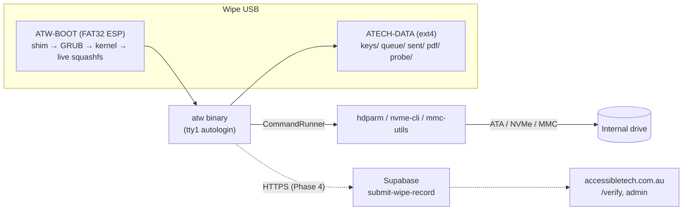

# Architecture

atw is a Rust program on a Debian live USB. It purges a laptop's internal drives with their own sanitize commands, reads every sector back, signs a record and queues it for sync to Supabase. See `docs/SPEC.md` for the full design; this file tracks what is built.

## Components

## Crates

- `atw-drive`: the `CommandRunner` trait (`SystemRunner` read-only, `FakeRunner` for tests), the read-only allowlist, lsblk parsing and boot-USB exclusion, host facts (Secure Boot, lockdown, DMI) and probe.
- `atw`: the binary. Phase 1: `atw probe`.

## Boot chain

UEFI firmware (Secure Boot on) → `EFI/boot/bootx64.efi` (Debian `shim-signed`, signed by Microsoft) → `grubx64.efi` (`grub-efi-amd64-signed`, signed by Debian) → Debian's signed `linux-image-amd64` → live-boot mounts `live/filesystem.squashfs`. With Secure Boot on, the kernel enables lockdown (`integrity`). atw needs no kernel modules of its own. The kernel command line carries `atw.live=1`.

At boot, root autologs in on tty1; `.bash_profile` runs `/usr/local/sbin/atw-start`, which mounts `LABEL=ATECH-DATA` at `/mnt/data` and runs `atw`.

## USB layout

GPT, built as a file by `image/mkimage.sh` and written by `image/make-usb.sh` (ADR 0002):

| # | Label | Type | Contents |
| --- | --- | --- | --- |
| 1 | ATW-BOOT | FAT32, EFI system partition | Files of the live ISO (EFI loaders, GRUB config, kernel, initrd, squashfs) |
| 2 | ATECH-DATA | ext4, rest of the stick | `keys/`, `queue/`, `sent/`, `pdf/`, `probe/` |

`make-usb.sh` gives partition 2 a fresh UUID on each stick. atw treats any disk carrying the `ATECH-DATA` label, or mounted at `/run/live/medium`, as the boot device and never touches it.
